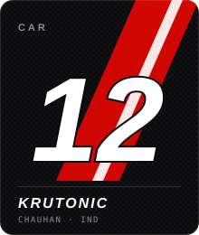

<!--
  ╔══════════════════════════════════════════════════════════════╗
  ║  KRUTARTH RACING · KRUTONIC MOTORSPORT DIVISION              ║
  ║  GitHub profile README. Each section starts with an          ║
  ║  "S#" comment, so edits stay quick and painless.             ║
  ╚══════════════════════════════════════════════════════════════╝
-->

<!-- ═══════════════ S1 · PADDOCK HERO ═══════════════ -->
<p align="center">
  
</p>

<p align="center">
  <a href="https://www.krutarthchauhan.co.in/"></a>
  <a href="https://krutonic.com"></a>
  <a href="mailto:contact@krutonic.com"></a>
</p>


<!-- ═══════════════ S2 · DRIVER PROFILE ═══════════════ -->
## `S1` &nbsp;DRIVER PROFILE

<table>
  <tr>
    <td width="220" align="center" valign="middle">
      
    </td>
    <td valign="top">

| | |
|:--|:--|
| **DRIVER** | Krutarth Chauhan |
| **TEAM** | KRUTONIC |
| **BASE** | Gujarat, India 🇮🇳 |
| **ROLE** | Full-Stack Developer |
| **SPECIALITY** | Web, Mobile, SaaS & AI Automation |
| **RACE NUMBER** | `#12` |
| **CURRENT STATUS** | 🟢 Building something interesting |

</td>
  </tr>
</table>

> **Pre-race notes:** I build products end to end: the interface people touch, the API it talks to, the database that remembers it, and the automation that quietly does the boring parts.
> I care about motion, performance and code the next engineer can read without a team radio.
>
> 🔧 *Race engineer says the build is stable. I have concerns.*


<!-- ═══════════════ S3 · ENGINE SPECIFICATIONS ═══════════════ -->
## `S2` &nbsp;ENGINE SPECIFICATIONS

<sub>Homologated for production. Tuned between coffee breaks.</sub>

| SYSTEM | COMPONENTS |
|:--|:--|
| **POWER UNIT** · Frontend |      |
| **AERODYNAMICS** · Animation |    |
| **CHASSIS** · Backend |     |
| **TELEMETRY** · Databases |     |
| **PIT WALL** · Cloud & DevOps |     |
| **RACE INTELLIGENCE** · AI |     |
| **MOBILE ENGINEERING** |   |


<!-- ═══════════════ S4 · RACE WEEKEND ═══════════════ -->
## `S3` &nbsp;RACE WEEKEND: CURRENT PROJECTS

<sub>Live classification. No penalties under investigation (yet).</sub>

| POSITION | PROJECT | CATEGORY | LINK |
|:--:|:--|:--|:--|
| 🟥 **P1** | **KRUTONIC**<br><sub>My software development company. We build websites, mobile apps, custom software, SaaS and AI automation.</sub> | Software Studio · SaaS · AI | [krutonic.com ↗](https://krutonic.com) |
| ⬜ **P2** | **NAKU LAUNDRY**<br><sub>A working laundry platform: web, React Native apps, Firebase and Stripe payments.</sub> | Web · Mobile · Payments | [nakulaundry.com ↗](https://nakulaundry.com) |
| ⬛ **P3** | **PERSONAL PORTFOLIO**<br><sub>My creative developer portfolio. Motion-heavy, and allergic to layout shift.</sub> | Creative Dev · Motion | [krutarthchauhan.co.in ↗](https://www.krutarthchauhan.co.in/) |


<!-- ═══════════════ S5 · RACE TELEMETRY ═══════════════ -->
## `S4` &nbsp;RACE TELEMETRY

<sub>Live feed from the GitHub pit wall. Numbers update on their own; I just drive.</sub>

<p align="center">
  
</p>

<p align="center">
  
  
</p>

<p align="center">
  
</p>


<!-- ═══════════════ S6 · TEAM RADIO ═══════════════ -->
## `S5` &nbsp;TEAM RADIO

```text
📻 LAP 12 ─────────────────────────────────────────────────────
ENGINEER  Krutarth, we have a problem with the deployment.
KRUTARTH  Copy. Have you tried restarting the server?
ENGINEER  We are checking.
KRUTARTH  Understood. Plan B.

📻 LAP 27 ─────────────────────────────────────────────────────
ENGINEER  Box this lap for a dependency update.
KRUTARTH  Negative. node_modules weighs more than the car.

📻 LAP 33 ─────────────────────────────────────────────────────
ENGINEER  Client wants "one small change".
KRUTARTH  Define small.
ENGINEER  ...it's a new feature.
KRUTARTH  Copy. Extending the stint.

📻 LAP 41 ─────────────────────────────────────────────────────
ENGINEER  All tests are green.
KRUTARTH  All of them?
ENGINEER  All the ones we wrote.

📻 LAP 58 ─────────────────────────────────────────────────────
ENGINEER  Friday deploy window is open.
KRUTARTH  No, no, no. Not this weekend. Hold position.
```


<!-- ═══════════════ S7 · PIT STOP / CONTACT ═══════════════ -->
## `S6` &nbsp;PIT STOP · CONTACT

| CHANNEL | FREQUENCY |
|:--|:--|
| 🏎️ **Portfolio** | [krutarthchauhan.co.in](https://www.krutarthchauhan.co.in/) |
| 🏁 **Company** | [krutonic.com](https://krutonic.com) |
| 🛠️ **GitHub** | [github.com/KITTU223](https://github.com/KITTU223) |
| 📡 **Email** | [contact@krutonic.com](mailto:contact@krutonic.com) |

<sub>Got a project, a collaboration or a bug that has people stumped? Open the radio. Response time beats most pit stops.</sub>

<br>

<p align="center">
  
</p>

<h3 align="center"><code>BOX BOX.</code> Time to ship. 🏁</h3>
