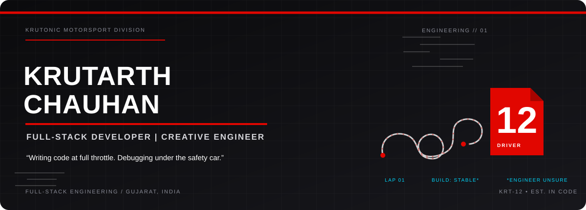

  

  <strong>Independent-minded engineering. Built for the long race.</strong> 
  Gujarat, India · Full-stack developer · Race number <strong>12</strong>

  <em>“Race engineer says the build is stable. I have concerns.”</em>

## 01 / DRIVER PROFILE

| PADDOCK PASS | DETAILS |
|:--|:--|
| **Driver** | Krutarth Chauhan |
| **Team** | KRUTONIC |
| **Base** | Gujarat, India |
| **Role** | Full-Stack Developer |
| **Speciality** | Web, mobile, SaaS & AI automation |
| **Race number** | #12 |
| **Current status** | Building something interesting |

I like taking an idea from the first sketch to something people can actually use—then staying around for the interesting bugs.

## 02 / ENGINE SPECIFICATIONS

| SYSTEM | SPECIFICATION |
|:--|:--|
| **POWER UNIT — FRONTEND** | React · Next.js · TypeScript · JavaScript · Tailwind CSS |
| **AERODYNAMICS — MOTION** | GSAP · Framer Motion · Lenis |
| **CHASSIS — BACKEND** | Node.js · Express.js · REST APIs · tRPC |
| **TELEMETRY — DATA** | PostgreSQL · MongoDB · Firebase · Supabase |
| **PIT WALL — CLOUD & DEVOPS** | Docker · AWS · Cloudflare · Vercel |
| **RACE INTELLIGENCE — AI** | n8n · AI agents · RAG · LLM APIs |
| **MOBILE ENGINEERING** | React Native · Expo |

## 03 / RACE WEEKEND — CURRENT PROJECTS

| POSITION | PROJECT | CATEGORY | LINK |
|:--:|:--|:--|:--|
| **P1** | **KRUTONIC** | Software studio · web, mobile, custom software, SaaS & AI automation | [krutonic.com](https://krutonic.com) |
| **P2** | **NAKU LAUNDRY** | Laundry platform · web, React Native, Firebase & Stripe | [nakulaundry.com](https://nakulaundry.com) |
| **P3** | **PERSONAL PORTFOLIO** | Creative developer portfolio | [Visit portfolio](https://www.krutarthchauhan.co.in/) |

## 04 / RACE TELEMETRY

Live cards below are generated by their respective services; numbers are not hand-entered. GitHub may take a moment to load external images.

  

  
  

## 05 / TEAM RADIO

> **ENGINEER:** “Krutarth, we have a problem with the deployment.”  
> **ME:** “Copy. Have you tried restarting the server?”  
> **ENGINEER:** “We are checking.”  
> **ME:** “Understood. Plan B: call it a feature flag.”

> **ENGINEER:** “The tests are green.”  
> **ME:** “All of them?”  
> **ENGINEER:** “We have green.”  
> **ME:** “That wasn’t the question.”

## 06 / PIT STOP — CONTACT

- **Portfolio:** [krutarthchauhan.co.in](https://www.krutarthchauhan.co.in/)
- **Company:** [krutonic.com](https://krutonic.com)
- **GitHub:** [@krutarthchauhan2000](https://github.com/krutarthchauhan2000)
- **Email:** [contact@krutonic.com](mailto:contact@krutonic.com)

<strong>BOX BOX. Time to ship.</strong>

